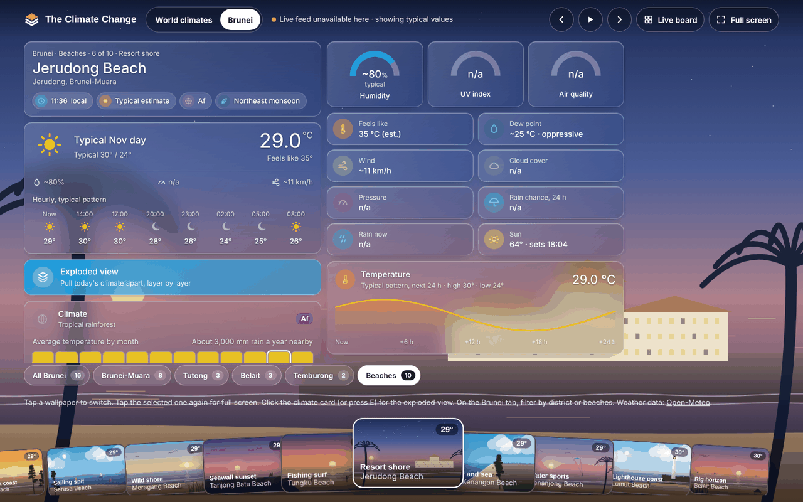

# The Climate Change

Animated, live-weather wallpapers that show what the climate is doing right now around the world and across Brunei. It was made for Brunei secondary students.

## Features

- **Animated scenes.** Every place is a hand-drawn canvas scene, built from layers that drift past each other as you move the mouse, with weather effects such as rain, snow, fog and lightning.
- **Live weather.** Temperature, feels-like, humidity, dew point, wind and gusts, UV, cloud cover, pressure, visibility, rain, a 24-hour forecast and a 7-day forecast, all from [Open-Meteo](https://open-meteo.com/).
- **Live air quality.** US AQI, PM2.5, PM10 and ozone for every place.
- **Dashboard.** Glass cards in a Home Assistant style: a weather card with hourly and daily forecasts, gauges, sensor tiles and a temperature graph. The glass darkens a little over bright scenes so the text stays readable.
- **Exploded view.** Press **E** or click the dashboard to pull a place's climate apart into six layers: sun and light, clouds and rain, wind, air quality, heat and humidity, and land. Each layer has its own charts and a short explanation.
- **Live board.** Every place in the current tab side by side, with comparisons such as hottest, coldest, windiest and highest UV.
- **Climate Corner.** A third tab with a filterable activity gallery that opens into a full-size viewer, plus an events calendar of school events and global climate days such as Earth Hour, Earth Day and World Environment Day. Each event can be added to your calendar as an `.ics` file.
- **No build step.** Everything is in one HTML file and works offline. When the live feed can't be reached, the page falls back to typical values for the month and time of day.

## Places

**World climates:** Kyoto, Riyadh, Tromsø, Zermatt, Santorini, Darwin, McMurdo Station.

**Brunei.** You can filter these by district or show only the beaches:

| District | Places |
|---|---|
| Brunei-Muara | Omar Ali Saifuddien Mosque, Kampong Ayer, Muara Beach, Serasa Beach, Meragang Beach, Tanjong Batu Beach, Tungku Beach, Jerudong Beach |
| Tutong | Tasek Merimbun, Seri Kenangan Beach, Penanjong Beach |
| Belait | Seria, Lumut Beach, Belait Beach |
| Temburong | Ulu Temburong National Park, Temburong Bridge |

## Editing the Climate Corner

The gallery and school events are stored in the `CORNER` list near the end of `index.html`. Entries marked `sample:true` are placeholders and show a **Sample** badge until you remove that flag.

- **Activities** have a title, category (`Clean-up`, `Planting`, `Campaign`, `Workshop` or `Science`), date, place, short and long descriptions, up to three stats and a "What we learned" list.
- **Photos:** put images in a `photos/` folder and list them, for example `photos:['photos/cleanup-1.jpg','photos/cleanup-2.jpg']`. The first photo becomes the cover, and the rest appear in the viewer. Without photos, a drawn illustration is shown instead.
- **Events** need a title, date (`YYYY-MM-DD`), time (`07:30–10:00`), place and short description.
- **Global climate days** are worked out automatically every year, so they don't need editing. Earth Hour follows WWF's rule: the last Saturday of March, moved a week earlier when that Saturday is Holy Saturday.

## Controls

| Key or action | What it does |
|---|---|
| ← / → or swipe | Previous or next place |
| F | Full screen |
| E | Exploded view |
| Esc | Close a panel |
| Tap a selected wallpaper | Full screen |

## Run it locally

Download the files and open `index.html` in a modern browser (Chrome, Edge, Firefox or Safari). There is nothing to install.

## Publish with GitHub Pages

1. Create a new repository on GitHub and upload `index.html`, `preview.png`, `README.md`, `.nojekyll` and the whole `photos` folder, keeping its folder structure.
2. In the repository, open **Settings → Pages**.
3. Under **Build and deployment**, choose **Deploy from a branch**, then pick `main` and `/ (root)`, and save.
4. After a minute or two the site will be live at `https://<your-username>.github.io/<repository-name>/`.

## Credits

- Weather and air-quality data: [Open-Meteo](https://open-meteo.com/), licensed under [CC BY 4.0](https://creativecommons.org/licenses/by/4.0/). Its free API is for non-commercial use.
- Fonts: [Sora](https://fonts.google.com/specimen/Sora), [Inter](https://fonts.google.com/specimen/Inter) and [Roboto](https://fonts.google.com/specimen/Roboto), from Google Fonts.
- Beach and place information: Brunei Tourism, Wikipedia and Lonely Planet.
- All illustrations are original and drawn in code.
